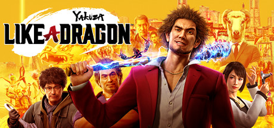

**Yakuza: Like a Dragon by Ryu Ga Gotoku Studio (2020) reinvents the Yakuza series as a turn-based JRPG.**

---

## 📖 About

Yakuza: Like a Dragon by Ryu Ga Gotoku Studio (2020) reinvents the Yakuza series as a turn-based JRPG. You play as Ichiban Kasuga, a Dragon Quest-obsessed ex-yakuza, building a party of misfits to take on Yokohama's criminal underworld. The true final dungeon is among the hardest in JRPG history.

## ⚠️ Problems Without Trainer

| Problem | Status |
|---------|--------|
| Palekana and Barracudas true dungeon bosses vastly exceed level expectations | ✅ Solved |
| Job change costs require huge poundmate income to maintain optimal party builds | ✅ Solved |
| Climax Battle challenges require max-level parties with specific job synergies | ✅ Solved |
| Random encounter grind in final dungeon necessary to reach required stats | ✅ Solved |
| Dragon Kart tournaments require precise racing lines to beat NPC times | ✅ Solved |

## ✅ Solution

The **Yakuza: Like a Dragon Trainer** solves all these issues, giving you complete control so you can focus on enjoying the game.

## 🎯 Features

- Unlimited Resources / Currency
- God Mode / Invincibility
- Instant Skill & Ability Cooldown
- One-Hit Kill
- Freeze Timers
- Unlock All Items & Achievements
- Custom Speed Multiplier
- Infinite Stamina / Energy

## 🚀 Quick Start

1. **Disable Windows Defender** temporarily (trainer may trigger false positive)
2. Get the trainer from the button above
3. Launch Yakuza: Like a Dragon
4. Run the trainer as Administrator
5. Use the hotkeys to activate cheats in-game

## 💎 Free vs Pro

| Feature | Free | Pro |
|---------|------|-----|
| God Mode | ✅ | ✅ |
| Unlimited Resources | ✅ | ✅ |
| Advanced Cheats | ❌ | ✅ |
| Auto-Updates | ❌ | ✅ |
| Priority Support | ❌ | ✅ |

## 💻 Requirements

- Windows 10 / 11 (64-bit)
- Yakuza: Like a Dragon (any version)
- .NET Framework 4.8+
- DirectX 11+

## 🍎 macOS

## ⚖️ Legal

Educational and single-player use only.

---

